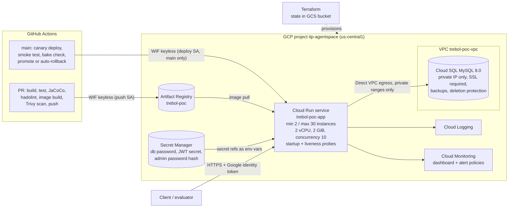

## 1. What this POC delivers

The existing Spring Boot e-commerce backend was containerised and deployed on Google Cloud Run, backed by Cloud SQL (MySQL 8.0) on a private network. Everything in the cloud is created by Terraform. A GitHub Actions pipeline builds, tests, scans and pushes the image on every pull request, and on every merge to `main` it deploys through a canary release with automatic rollback. No application code was changed.

## 2. Architecture

Key design points:

- **Stateless service.** Authentication is JWT-based with no server-side session, so any instance can serve any request and instances can be added or removed freely.
- **Private database.** Cloud SQL has no public IP. Cloud Run reaches it over Direct VPC egress; only private ranges leave through the VPC.
- **Secrets in a vault.** Database password, JWT signing key and admin password hash live in Secret Manager and are injected as environment variables through secret references. No secret is in the repository or in a pipeline file.
- **Keyless CI/CD.** GitHub Actions authenticates with Workload Identity Federation (OIDC). The push identity can be used from any ref of this repository; the deploy identity only from `refs/heads/main`.
- **Least privilege.** Three dedicated service accounts (runtime, CI push, CI deploy), each with only the roles it needs. No authoritative IAM resources are used because the project is shared.

## 3. Requirement traceability

| # | Requirement | Status | Where to look |
|---|---|---|---|
| 1 | Analysis document | Done | `01-application-analysis.md` |
| 2 | Multi-stage, non-root, slim image; docker-compose; no critical CVEs | Image built (about 583 MB with AppCDS; startup about 21 s to about 6 s) and compose file in repo. CVE scan runs in CI in **report-only** mode. See the caveat in `11-vulnerability-report.md` | `trebol-backend-monolith/Dockerfile`, `11-vulnerability-report.md` |
| 3 | CI/CD: PR (build, tests, quality, image, scan, push); main (deploy, smoke test, publish status); no secrets in pipeline files | Done and proven on GitHub (PR #2, PR #3, deploy run #1) | `.github/workflows/pr.yml`, `deploy.yml` |
| 4 | Managed container platform, secrets in a vault, least privilege, public HTTPS URL | Cloud Run, Secret Manager, 3 service accounts: done. **URL is HTTPS but private (IAM-protected)** because the organisation's domain-restricted-sharing policy blocks `allUsers` | `02-deployment-guide.md` section 7 |
| 5 | Stateless, at least 2 instances, probes, autoscaling, limits, zero-downtime rollouts | Done: min 2, max 30, concurrency 10, 2 vCPU / 2 GiB, database `db-custom-2-7680`, readiness and liveness probes, canary traffic split | `03-scaling-strategy.md` |
| 6 | Load test: 10,000 users, P95 under 500 ms, errors under 1% | **Not run at 10,000 users** (agreed scope). Measured up to 400 simulated users; errors 0%; P95 target missed at 400 users because of scale-out lag. A load-ready profile and a projection are provided | `04-test-report.md` Sample test at 1,000 req/s: client P95 392 ms (passed), 19 instances, Cloud SQL CPU about 5% (`04-test-report.md`) |
| 7 | Central logs, dashboard, alerts, at least one test alert firing | Logs central by default; dashboard and 4 alert policies applied via Terraform. **Test alert not yet fired** | `05-alert-strategy.md` |
| Bonus | Infrastructure as code | Done (Terraform) | `infra/terraform/` |
| Bonus | Canary with automatic rollback | Implemented in `deploy.yml`; canary path proven, rollback path **not yet exercised** | `03-scaling-strategy.md` |
| Bonus | Multi-region | Documented only | `07-multi-region-note.md` |
| Bonus | Cost analysis | Done (estimate; budget alert not yet created) | `06-cost-analysis.md` |

## 4. Environments

| Environment | Where | Purpose |
|---|---|---|
| dev | Developer laptop, `docker compose` | Build and verify the container, Flyway migrations and actuator probes locally |
| prod | GCP project `itp-agentspace` | The only cloud environment, to keep cost under the USD 50/month limit |

## 5. Operating the stack (cost control)

The project is shared and cost-limited, so the cloud stack is only kept running while it is being worked on. `scripts/poc.ps1 up|down|status` starts and stops it: `up` starts the database and sets Cloud Run to 2 minimum instances; `down` sets Cloud Run to 0 and stops the database. Run `down` at the end of every session.

## 6. Document index

| File | Content |
|---|---|
| `01-application-analysis.md` | What the application is and what the cloud design had to account for |
| `02-deployment-guide.md` | Exact steps to build, deploy, operate and tear down |
| `03-scaling-strategy.md` | Autoscaling model, capacity maths, tuning levers, rollout safety |
| `04-test-report.md` | Load-test results, interpretation and tuning |
| `05-alert-strategy.md` | Alerts, thresholds, dashboard, runbook |
| `06-cost-analysis.md` | Cost model and controls |
| `07-multi-region-note.md` | How the design would extend to multiple regions |
| `11-vulnerability-report.md` | Scanning approach and policy |
